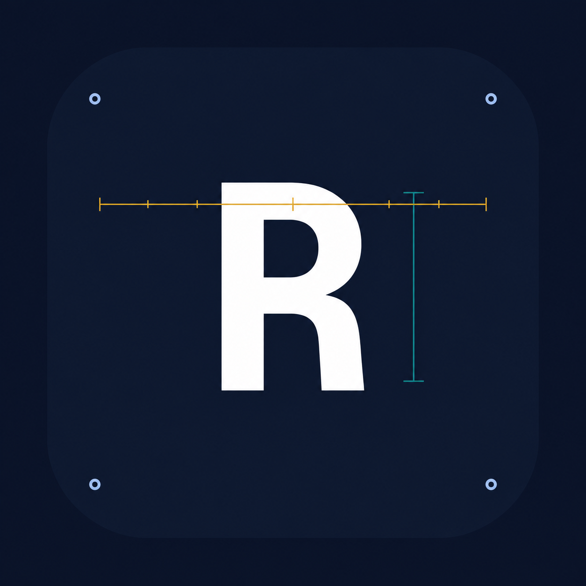

<p align="center">
  
</p>

# RuleMetric documentation

Measure whether changes to AI coding-agent instructions improve results.

RuleMetric captures coding sessions, surfaces instruction suggestions, and runs controlled comparisons of quality, cost, and latency. This repository contains the public guides and references for using RuleMetric.

[Website](https://rulemetric.com) · [Hosted documentation](https://rulemetric.com/docs) · [LinkedIn](https://www.linkedin.com/company/rulemetric/)

## Start here

```bash
npm install -g @rulemetric/cli
rulemetric auth signup       # or: rulemetric auth login
rulemetric setup plan        # preview setup changes
rulemetric setup             # guided setup in an interactive terminal
```

Follow the [quick start](docs/quickstart.md) for authentication, session capture, the background worker, verification, and local mode.

## Guides and references

| Document | What it covers |
| --- | --- |
| [Quick start](docs/quickstart.md) | Install, authenticate, capture sessions, and verify setup |
| [Integrating an agent](docs/integrate.md) | Configure an agent and use the CLI, HTTP API, or MCP server |
| [Suggestions](docs/suggestions.md) | Review proposals, run comparisons, and read outcomes |
| [CLI reference](docs/cli.md) | Commands, arguments, and flags |
| [HTTP API reference](docs/api.md) | Authentication and product endpoints |
| [MCP tools and resources](docs/mcp-tools.md) | Tool inputs, outputs, and documentation resources |

## Contribute

Found an unclear step, outdated command, or missing example? Open an issue or submit a pull request. See [CONTRIBUTING.md](CONTRIBUTING.md).

These guides were initially imported from RuleMetric's published, agent-readable documentation on October 8, 2026. The CLI reference identifies the version it documents. Product releases and documentation updates are reviewed together; a repository merge does not automatically update the hosted documentation.

## License

The documentation is available under the [MIT License](LICENSE). The RuleMetric name and logo identify the project; the license does not grant trademark rights.
